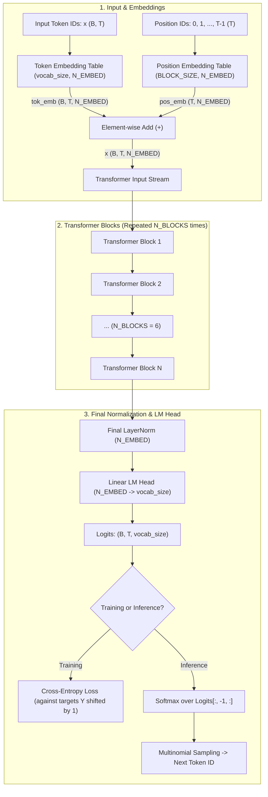
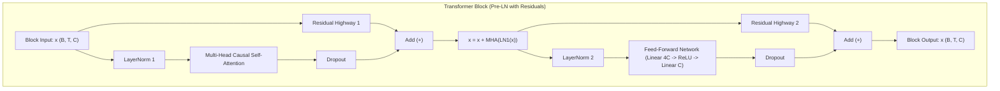
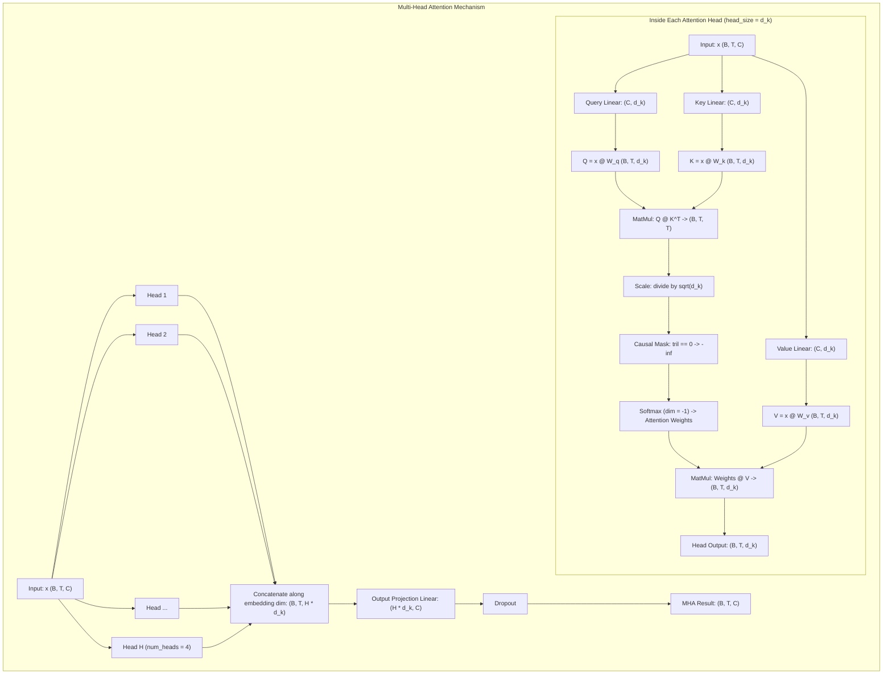

# Character-Level GPT from Scratch (Transformer Decoder)

A from-scratch implementation of an autoregressive, character-level **Generative Pre-trained Transformer (GPT)** in PyTorch, inspired by Andrej Karpathy's *Zero to Hero* series.

This repository tracks the complete journey of building a decoder-only Transformer: starting from a simple bigram baseline, deriving the mathematical trick of causal self-attention through four iterative stages, assembling multi-head attention and feed-forward blocks with residual connections and layer normalization, and finally training a full GPT model to generate Shakespeare-like prose.

---

## Table of Contents

- [Overview & Architecture Diagram](#overview--architecture-diagram)
  - [High-Level Architecture](#high-level-architecture)
  - [Inside a Transformer Block](#inside-a-transformer-block)
  - [Causal Multi-Head Self-Attention Detail](#causal-multi-head-self-attention-detail)
- [The Step-by-Step Learning Journey](#the-step-by-step-learning-journey)
  - [1. Tokenization and Data Batching](#1-tokenization-and-data-batching)
  - [2. The Baseline: Bigram Language Model (`bigram.py`)](#2-the-baseline-bigram-language-model-bigrampy)
  - [3. The Mathematical Trick in Self-Attention (4-Stage Progression)](#3-the-mathematical-trick-in-self-attention-4-stage-progression)
  - [4. Why the Scaling Factor \(\sqrt{d_k}\) is Vital](#4-why-the-scaling-factor-sqrtd_k-is-vital)
  - [5. Multi-Head Attention](#5-multi-head-attention)
  - [6. Position-Wise Feed-Forward Network](#6-position-wise-feed-forward-network)
  - [7. Residual Connections and Pre-LayerNorm](#7-residual-connections-and-pre-layernorm)
  - [8. Assembling the Full Transformer Decoder (`v2.py`)](#8-assembling-the-full-transformer-decoder-v2py)
- [Mathematical Formulations](#mathematical-formulations)
- [Model Configurations and Hyperparameters](#model-configurations-and-hyperparameters)
- [Training Dynamics and Generation](#training-dynamics-and-generation)
- [Project Files](#project-files)
- [Requirements and How to Run](#requirements-and-how-to-run)
- [Key Takeaways and Insights](#key-takeaways-and-insights)

---

## Overview & Architecture Diagram

The model implemented in [`v2.py`](./v2.py) is a **Decoder-Only Transformer Language Model**. Given a sequence of characters, it predicts the probability distribution of the next character.

### High-Level Architecture



---

### Inside a Transformer Block

Each block utilizes a **Pre-LayerNorm** formulation with residual (skip) connections around the attention and feed-forward sublayers.



---

### Causal Multi-Head Self-Attention Detail

Inside the multi-head self-attention layer, $h$ heads operate in parallel. Each head projects inputs into Queries, Keys, and Values, applies the causal lower-triangular mask, computes scaled dot-product attention, and outputs a context-aware representation.



---

## The Step-by-Step Learning Journey

This repository explores the full developmental arc from raw text to a functional generative model. The implementation details are outlined below.

### 1. Tokenization and Data Batching

- **Character-Level Tokenizer**:
  Rather than using subword tokenization (such as BPE), the model treats each unique character as a token. On `input.txt` (the Tiny Shakespeare dataset), there are 65 unique characters (`a-z`, `A-Z`, punctuation, spaces, and newlines).
  - String to integer: `stoi: dict[str, int]`
  - Integer to string: `itos: dict[int, str]`
- **Dataset Split**:
  The encoded integer sequence is split contiguously into 90% training data and 10% validation data.
- **Context Windows (`BLOCK_SIZE = 256`) and Shifted Targets**:
  During training, batches of random chunks of length `BLOCK_SIZE` are sampled:
  ```python
  x = source[i : i + BLOCK_SIZE]
  y = source[i + 1 : i + BLOCK_SIZE + 1]
  ```
  This creates pairs where each position $t \in [0, \text{BLOCK\_SIZE}-1]$ in $x$ is supervised to predict $y[t] = x[t+1]$, training the model on context lengths from $1$ token up to `BLOCK_SIZE` tokens simultaneously.

---

### 2. The Baseline: Bigram Language Model (`bigram.py`)

In [`bigram.py`](./bigram.py), each token predicts the next token based exclusively on its own identity, using an embedding lookup table without any inter-token communication:

$$\text{Logits}(x_t) = \text{EmbeddingTable}(x_t)$$

- **Limitation**: While simple and fast, a bigram model has zero memory of previous tokens ($x_{t-1}, x_{t-2}, \dots$).
- **Performance**: The loss plateaus at roughly $\sim 2.5$ nats (down from a purely random uniform loss of $-\ln(1/65) \approx 4.17$). The generated output contains English-like letter combinations, but lacks word structure, syntax, or context.

---

### 3. The Mathematical Trick in Self-Attention (4-Stage Progression)

To capture long-range dependencies, tokens need a mechanism to look back at previous tokens in the sequence. In [`gpt_dev.ipynb`](./gpt_dev.ipynb) and [`gpt.ipynb`](./gpt.ipynb), self-attention is derived through four developmental stages:

#### Version 1: Naive Averaging via For-Loops
For each position $t$, compute the mean of all past token representations up to $t$:
```python
xbow = torch.zeros((B, T, C))
for b in range(B):
    for t in range(T):
        xprev = x[b, : t + 1]  # (t + 1, C)
        xbow[b, t] = torch.mean(xprev, 0)
```
*Downside*: Extremely slow due to nested Python loops ($O(B \cdot T^2)$).

#### Version 2: Matrix Multiplication with Lower Triangular Matrix (`torch.tril`)
We can replace the loop with batched matrix multiplication. A lower-triangular matrix of ones normalized along each row acts as a rolling-average operator:
```python
weights = torch.tril(torch.ones(T, T))
weights = weights / weights.sum(dim=1, keepdim=True)
xbow = weights @ x  # (B, T, T) @ (B, T, C) -> (B, T, C)
```

#### Version 3: Softmax and Masking
Instead of manual row-normalization, apply `torch.masked_fill` with $-\infty$ to the upper triangle, followed by `F.softmax`:
```python
tril = torch.tril(torch.ones(T, T))
weights = torch.zeros((T, T))
weights = weights.masked_fill(tril == 0, float("-inf"))
weights = F.softmax(weights, dim=-1)  # -inf becomes 0.0 under softmax
xbow = weights @ x
```

#### Version 4: Self-Attention with Query, Key, and Value Projections
Uniform averaging is data-agnostic: every past token contributes equally. **Self-Attention** makes this affinity data-dependent:
1. **Query ($Q$)**: *"What kind of information am I looking for?"*
2. **Key ($K$)**: *"What kind of information do I contain?"*
3. **Value ($V$)**: *"What information do I communicate if you attend to me?"*

Each token emits a Query, Key, and Value vector via linear projections without bias:
```python
keys = self.key(x)      # (B, T, head_size)
queries = self.query(x)  # (B, T, head_size)
values = self.value(x)   # (B, T, head_size)

# Dot-product affinities
weights = queries @ keys.transpose(-2, -1) * (head_size ** -0.5)
# Causal masking: cannot look into the future
weights = weights.masked_fill(self.tril[:T, :T] == 0, float("-inf"))
weights = F.softmax(weights, dim=-1)

out = weights @ values  # (B, T, head_size)
```

---

### 4. Why the Scaling Factor \(\sqrt{d_k}\) is Vital

When $Q$ and $K$ have zero mean and unit variance ($\text{Var}(Q) = \text{Var}(K) = 1$):

$$\text{Var}\left(\sum_{i=1}^{d_k} Q_i K_i\right) = d_k$$

Without scaling, as $d_k$ increases, the variance of the dot products grows proportionally to $d_k$. Large dot-product values cause the softmax function to saturate:
- The largest value approaches $1.0$, while all others collapse to $0.0$.
- The softmax gradients vanish ($\frac{\partial \text{softmax}}{\partial z} \approx 0$), halting gradient backpropagation through the attention heads.

Dividing by $\sqrt{d_k}$ normalizes the variance back to $1.0$, keeping the softmax in an active, gradient-friendly regime.

---

### 5. Multi-Head Attention

A single attention head can only attend to one relationship pattern at a time (e.g., finding the previous consonant). **Multi-Head Attention** initializes multiple independent heads running in parallel:
- In [`v2.py`](./v2.py), each head produces an output of size `HEAD_SIZE`.
- The outputs of all heads are concatenated along the feature dimension:
  $$\text{Concat}(\text{head}_1, \text{head}_2, \dots, \text{head}_h) \in \mathbb{R}^{B \times T \times (h \cdot d_k)}$$
- A linear projection layer projects this concatenated representation back to `N_EMBED`, followed by a dropout layer for regularization.

---

### 6. Position-Wise Feed-Forward Network

Self-attention is a **communication mechanism** where tokens exchange information across the time axis. However, tokens also need **computation time** to process and transform the aggregated data.

The [`FeedForward`](./v2.py#L58-L72) module applies a position-wise Multi-Layer Perceptron (MLP) independently to each token:

$$\text{FFN}(x) = \text{Dropout}\left(\max\left(0, x W_1 + b_1\right) W_2 + b_2\right)$$

- $W_1$ expands the dimension by a factor of 4: from `N_EMBED` to $4 \times \text{N\_EMBED}$.
- A non-linear activation (`ReLU`) is applied.
- $W_2$ projects back down from $4 \times \text{N\_EMBED}$ to `N_EMBED`.
- Dropout is applied for regularization.

---

### 7. Residual Connections and Pre-LayerNorm

Deep networks (stacking 6 or more Transformer blocks) are prone to vanishing gradients during backpropagation. Two architectural choices ensure stable gradient flow:

1. **Residual (Skip) Connections**:
   $$x \leftarrow x + \text{Sublayer}(\text{LayerNorm}(x))$$
   The addition operator acts as a **gradient highway**, allowing loss gradients to flow back directly through the skip branches without attenuation.
2. **Layer Normalization vs. Batch Normalization**:
   Unlike Batch Normalization (which normalizes across the batch dimension and depends on batch statistics), LayerNorm computes the mean and variance across the feature dimension for each token independently:
   $$\text{LN}(x) = \frac{x - \mu}{\sqrt{\sigma^2 + \epsilon}} \odot \gamma + \beta$$
3. **Pre-LN vs. Post-LN**:
   The original 2017 Transformer paper (*"Attention Is All You Need"*) used Post-LN ($x \leftarrow \text{LN}(x + \text{Sublayer}(x))$). Modern GPT models use **Pre-LN** (normalizing the input before each sublayer). This improves numerical stability and enables training deep architectures without sensitive learning rate warm-up schedules.

---

### 8. Assembling the Full Transformer Decoder (`v2.py`)

All components come together in [`BigramLanguageModel`](./v2.py#L89-L126):
1. **Token Embeddings** (`vocab_size` $\to$ `N_EMBED`) and **Learned Position Embeddings** (`BLOCK_SIZE` $\to$ `N_EMBED`) are summed.
2. The sequence passes sequentially through `N_BLOCKS` Transformer blocks.
3. A final LayerNorm is applied to the output of the final block.
4. A linear Language Model head (`lm_head`) projects the embeddings to vocabulary logits.
5. In training mode, cross-entropy loss is computed against targets shifted by 1 position.
6. In generation mode, tokens are sampled autoregressively from the softmax distribution.

---

## Mathematical Formulations

| Operation | Equation |
| :--- | :--- |
| **Input Representation** | $x^{(0)}_t = \text{Embed}_{\text{tok}}(w_t) + \text{Embed}_{\text{pos}}(t)$ |
| **Scaled Dot-Product Attention** | $\text{Attention}(Q, K, V) = \text{softmax}\left(\frac{Q K^T}{\sqrt{d_k}} + M\right) V$ |
| **Causal Mask** | $M_{i,j} = \begin{cases} 0 & \text{if } j \le i \\ -\infty & \text{if } j > i \end{cases}$ |
| **Multi-Head Projection** | $\text{MHA}(x) = \left[\text{head}_1 \,\|\, \text{head}_2 \,\|\, \dots \,\|\, \text{head}_h\right] W^O$ |
| **Transformer Block (Pre-LN)** | $x' = x + \text{MHA}(\text{LN}_1(x))$<br>$x'' = x' + \text{FFN}(\text{LN}_2(x'))$ |
| **Cross-Entropy Loss** | $\mathcal{L} = -\frac{1}{B \cdot T} \sum_{i=1}^{B \cdot T} \log P(y_i \mid x_{\le i})$ |

---

## Model Configurations and Hyperparameters

Summary of the hyperparameters configured in [`v2.py`](./v2.py) and [`bigram.py`](./bigram.py):

| Hyperparameter | Baseline (`bigram.py`) | Scaled GPT (`v2.py`) | Purpose |
| :--- | :---: | :---: | :--- |
| **Vocabulary Size** | 65 | 65 | Distinct characters in Shakespeare dataset |
| **Batch Size (`BATCH_SIZE`)** | 32 | 64 | Independent sequences processed in parallel |
| **Context Length (`BLOCK_SIZE`)** | 8 | 256 | Maximum tokens the model can look back at |
| **Embedding Width (`N_EMBED`)** | 32 | 384 | Channel dimension of token/position vectors |
| **Transformer Blocks (`N_BLOCKS`)** | 0 | 6 | Number of stacked Transformer layers |
| **Attention Heads (`num_heads`)** | — | 4 | Number of parallel self-attention heads |
| **Head Dimension (`HEAD_SIZE`)** | — | 6 | Dimension of key, query, and value vectors |
| **Dropout (`DROPOUT`)** | 0.0 | 0.2 | Probability of zeroing activations during training |
| **Learning Rate** | `1e-2` | `3e-4` | Learning rate for AdamW optimizer |
| **Training Steps (`MAX_ITERS`)** | 3000 | 5000 | Total optimization steps |
| **Total Parameters** | ~2.1 K | **~7.47 M** | Full trainable parameter count |

---

## Training Dynamics and Generation

### Loss Progression
- **Initial Random Loss**: $\approx -\ln(1/65) \approx 4.17$ nats.
- **Bigram Loss**: Drops to $\sim 2.50$, where it hits a performance ceiling due to lack of historical context.
- **Transformer Decoder Loss**: Progresses down to $\sim 1.5 - 1.8$, learning syntax, dialogue formatting, Shakespearean vocabulary, and character tags.

### Autoregressive Text Generation
Text generation proceeds one token at a time:
1. Initialize the sequence with a single prompt token (e.g., token `0`).
2. Crop the current sequence to the most recent `BLOCK_SIZE` characters.
3. Perform a forward pass to compute logits for all positions.
4. Extract logits at the final position: `logits[:, -1, :]`.
5. Convert logits to probabilities via softmax.
6. Sample the next token index from this distribution using `torch.multinomial`.
7. Concatenate the sampled token to the context and repeat.

---

## Project Files

| File | Description |
| :--- | :--- |
| [`v2.py`](./v2.py) | **Main production script**: complete character-level Transformer with multi-head causal self-attention, feed-forward layers, residual connections, layer normalization, training loop, and autoregressive generation. |
| [`bigram.py`](./bigram.py) | **Baseline model**: minimal character-level bigram model using only token embedding lookup tables for comparison. |
| [`gpt_dev.ipynb`](./gpt_dev.ipynb) | **Development notebook**: interactive walkthrough deriving self-attention from scratch (naive loops $\to$ matrix multiply $\to$ softmax masking $\to$ scaled $Q, K, V$), LayerNorm implementation, and parameter scaling experiments. |
| [`gpt.ipynb`](./gpt.ipynb) | **Scratchpad notebook**: exploratory experiments with dataset loading, character mappings, and self-attention toy examples. |
| `input.txt` | The Tiny Shakespeare corpus (~1.1 MB, 1,115,394 characters) used as the local training and validation dataset. |

---

## Requirements and How to Run

### Requirements
- Python 3.8+
- PyTorch (with CUDA support if a GPU is available)

Install PyTorch according to your platform using the [official PyTorch installation guide](https://pytorch.org/get-started/locally/).

### Running the Transformer (`v2.py`)

```bash
python3 v2.py
```

The script will automatically use CUDA if available, train for 5,000 iterations while periodically printing train and validation loss, and conclude by generating 500 characters of Shakespeare-style text.

### Running the Baseline (`bigram.py`)

```bash
python3 bigram.py
```

Runs the bigram baseline for 3,000 steps to demonstrate the difference in generation quality when no attention mechanism is present.

---

## Key Takeaways and Insights

1. **Attention as Communication**: Self-attention can be viewed as a directed graph where every token looks back at preceding tokens and pulls relevant information.
2. **Feed-Forward as Computation**: While attention aggregates information across time, the feed-forward network lets each token reflect on and process the aggregated data independently.
3. **Causality through Masking**: Replacing future affinities with $-\infty$ ensures tokens can never look ahead into future positions, preserving the autoregressive property.
4. **Gradient Highways**: Deep Transformer models rely critically on residual connections and pre-layer normalization to maintain stable gradient magnitudes throughout backpropagation.
5. **From Scratch Understanding**: Building each layer manually reveals exactly why modern LLMs behave the way they do — from context window limitations to autoregressive sampling mechanics.
