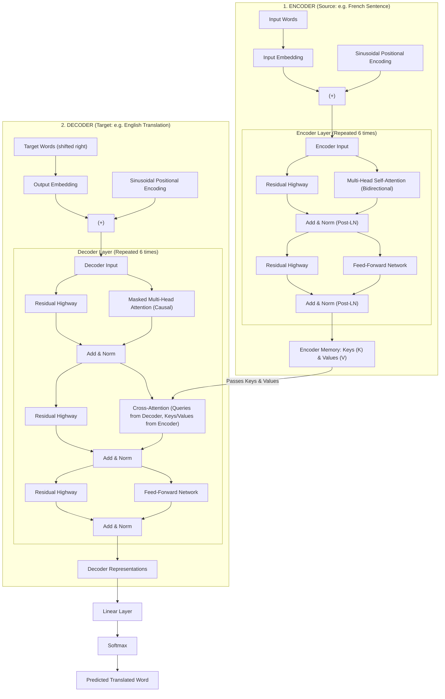
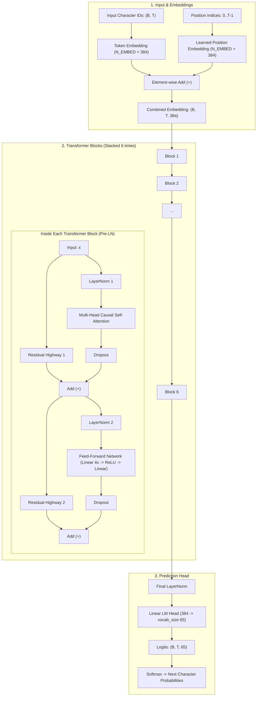
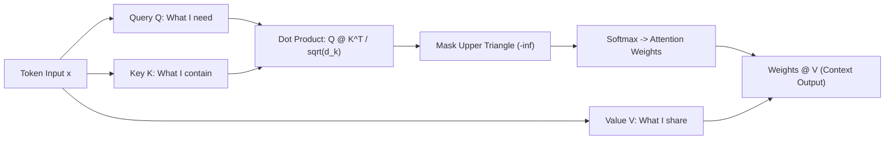

# Character-Level GPT from Scratch: Building a Transformer Language Model

A from-scratch implementation of an autoregressive **Decoder-Only Transformer (GPT)** in PyTorch, inspired by Andrej Karpathy's *Zero to Hero* series and the original research paper [*Attention Is All You Need*](https://arxiv.org/abs/1706.03762) (Vaswani et al., 2017).

This project walks through the entire journey of building a generative language model: from a simple bigram lookup baseline, to mathematically deriving self-attention from scratch, to assembling a complete multi-layer Transformer that writes Shakespeare-like prose.

---

## Table of Contents

1. [Transformer Architectures: The Paper vs. What I Built](#1-transformer-architectures-the-paper-vs-what-i-built)
   - [The Original Paper Architecture (*Attention Is All You Need*)](#a-the-original-paper-architecture-attention-is-all-you-need)
   - [My Architecture: Decoder-Only GPT (`v2.py`)](#b-my-architecture-decoder-only-gpt-v2py)
   - [Comparison: Original Paper vs. My GPT Implementation](#c-comparison-original-paper-vs-my-gpt-implementation)
2. [How It Works: Step-by-Step (Concept + Code)](#2-how-it-works-step-by-step-concept--code)
   - [Step 1: Tokenization and Data Batching](#step-1-tokenization-and-data-batching)
   - [Step 2: The Baseline Model (`bigram.py`)](#step-2-the-baseline-model-bigrampy)
   - [Step 3: The Intuition of Self-Attention (4-Stage Progression)](#step-3-the-intuition-of-self-attention-4-stage-progression)
   - [Step 4: Single-Head Causal Attention (`SingleHeadAttention`)](#step-4-single-head-causal-attention-singleheadattention)
   - [Step 5: Multi-Head Attention (`MultiHeadAttention`)](#step-5-multi-head-attention-multiheadattention)
   - [Step 6: Feed-Forward Network (`FeedForward`)](#step-6-feed-forward-network-feedforward)
   - [Step 7: Residual Connections & Pre-LayerNorm (`Block`)](#step-7-residual-connections--pre-layernorm-block)
   - [Step 8: Assembling the Full GPT Model (`BigramLanguageModel`)](#step-8-assembling-the-full-gpt-model-bigramlanguagemodel)
3. [Text Generation & Results Comparison](#3-text-generation--results-comparison)
4. [Model Hyperparameters](#4-model-hyperparameters)
5. [Project Files](#5-project-files)
6. [How to Run](#6-how-to-run)
7. [Key Lessons Learned](#7-key-lessons-learned)

---

## 1. Transformer Architectures: The Paper vs. What I Built

### A. The Original Paper Architecture (*Attention Is All You Need*)

In the 2017 paper by Vaswani et al., the Transformer was designed for **Machine Translation** (e.g. converting French sentences into English). Because translation has an input language and an output language, it required an **Encoder-Decoder** dual-tower design:



- **Encoder**: Reads the full input sentence all at once. Tokens can look both left and right (**bidirectional attention**).
- **Cross-Attention**: Allows the decoder to "look back" at the encoder's processed source sentence while generating translated words.
- **Decoder**: Predicts words one-by-one. It uses a **causal mask** so it cannot peek into future target words.

---

### B. My Architecture: Decoder-Only GPT (`v2.py`)

For general text generation (like ChatGPT and this project), we don't need two separate languages or an encoder. Instead, the model only needs to read a single text stream and predict what comes next.

This is the **Decoder-Only Transformer** implemented in [`v2.py`](./v2.py):



---

### C. Comparison: Original Paper vs. My GPT Implementation

| Feature | *Attention Is All You Need* (2017) | My Decoder-Only GPT ([`v2.py`](./v2.py)) | Why This Matters |
| :--- | :--- | :--- | :--- |
| **Model Type** | **Encoder-Decoder** (2 towers) | **Decoder-Only** (1 tower) | Next-token prediction handles prompts and generation in one unified stream. |
| **Attention Layers** | Bidirectional Self-Attn + Causal Self-Attn + Cross-Attn | **Causal Masked Self-Attention Only** | Simpler architecture; no separate encoder memory to cross-attend to. |
| **Layer Normalization** | **Post-LN**: $x \leftarrow \text{LN}(x + \text{Sublayer}(x))$ | **Pre-LN**: $x \leftarrow x + \text{Sublayer}(\text{LN}(x))$ | Pre-LN keeps the residual skip highway clean, making deep networks much easier to train. |
| **Positional Encoding** | Fixed Sinusoidal math functions ($\sin / \cos$) | **Learned Embedding Table** (`nn.Embedding`) | Learned embeddings adapt to data and are straightforward to implement. |
| **Task** | Machine Translation | Character-Level Autoregressive Text Generation | Model learns Shakespearean grammar and dialogue directly from raw characters! |

---

## 2. How It Works: Step-by-Step (Concept + Code)

Here is exactly what I built in code, broken down into simple, intuitive concepts.

### Step 1: Tokenization and Data Batching

Instead of complex word or subword tokenizers, I built a character-level tokenizer from `input.txt` (Tiny Shakespeare):
- **Vocabulary**: 65 unique characters (`a-z`, `A-Z`, punctuation, spaces).
- **Encoder/Decoder**: Maps each character to an integer ID and back:
  ```python
  stoi = {ch: i for i, ch in enumerate(chars)}
  itos = {i: ch for i, ch in enumerate(chars)}
  encode = lambda s: [stoi[c] for c in s]
  decode = lambda ids: "".join(itos[i] for i in ids)
  ```
- **Context Windows (`BLOCK_SIZE = 256`)**: Random text chunks are fed to the model where target $Y$ is simply input $X$ shifted by 1 character:
  ```python
  x = source[i : i + BLOCK_SIZE]
  y = source[i + 1 : i + BLOCK_SIZE + 1]
  ```

---

### Step 2: The Baseline Model (`bigram.py`)

Before building the Transformer, I built a simple baseline in [`bigram.py`](./bigram.py).
- **How it works**: It looks *only* at the current character to guess the next character using a single lookup table.
- **The flaw**: It has zero context memory. It cannot remember what character came two steps ago.
- **Result**: Loss plateaus at $\sim 2.50$, outputting noisy, barely recognizable character combinations.

---

### Step 3: The Intuition of Self-Attention (4-Stage Progression)

In [`gpt_dev.ipynb`](./gpt_dev.ipynb), I derived the self-attention mechanism in 4 progressive steps:

1. **Stage 1 (Naive Average)**: Use nested `for` loops to average all past token vectors. (Too slow: $O(T^2)$ in Python).
2. **Stage 2 (Matrix Multiply Trick)**: Use a lower-triangular matrix of ones (`torch.tril`) to compute rolling averages instantly with matrix multiplication:
   ```python
   weights = torch.tril(torch.ones(T, T))
   weights = weights / weights.sum(dim=1, keepdim=True)
   out = weights @ x
   ```
3. **Stage 3 (Softmax Masking)**: Replace zeros in the upper triangle with $-\infty$, then apply `softmax`. Because $e^{-\infty} = 0$, future tokens are completely blocked!
4. **Stage 4 (Self-Attention)**: Instead of uniform averaging, let the tokens **decide** who to pay attention to using Queries and Keys!

---

### Step 4: Single-Head Causal Attention (`SingleHeadAttention`)

Every token creates three vectors:
- **Query ($Q$)**: *"What am I looking for?"*
- **Key ($K$)**: *"What information do I have?"*
- **Value ($V$)**: *"What information will I pass along if you attend to me?"*



#### Here is my implementation in [`v2.py`](./v2.py):
```python
class SingleHeadAttention(nn.Module):
    def __init__(self, head_size=HEAD_SIZE):
        super().__init__()
        self.key = nn.Linear(N_EMBED, head_size, bias=False)
        self.query = nn.Linear(N_EMBED, head_size, bias=False)
        self.value = nn.Linear(N_EMBED, head_size, bias=False)
        self.register_buffer("tril", torch.tril(torch.ones(BLOCK_SIZE, BLOCK_SIZE)))
        self.scale = head_size ** -0.5  # 1 / sqrt(head_size)

    def forward(self, x):
        _, time, _ = x.shape
        keys = self.key(x)        # (B, T, head_size)
        queries = self.query(x)    # (B, T, head_size)
        
        # Calculate affinity scores and scale to prevent softmax saturation
        weights = queries @ keys.transpose(-2, -1) * self.scale
        # Causal mask: cannot attend to future characters
        weights = weights.masked_fill(self.tril[:time, :time] == 0, float("-inf"))
        weights = F.softmax(weights, dim=-1)
        
        return weights @ self.value(x)
```

> **Why scale by $\frac{1}{\sqrt{d_k}}$?**
> When dot-multiplying $Q$ and $K$, the variance scales with the vector length $d_k$. Large values cause `softmax` to peak sharply, driving gradients to near zero (vanishing gradients). Dividing by $\sqrt{d_k}$ keeps the variance at 1.0!

---

### Step 5: Multi-Head Attention (`MultiHeadAttention`)

A single attention head can only focus on one pattern at a time (e.g., finding the previous vowel). **Multi-Head Attention** runs several heads in parallel, allowing the model to track multiple relationships simultaneously (e.g., rhyming, syntax, dialogue structure).

#### Here is my implementation in [`v2.py`](./v2.py):
```python
class MultiHeadAttention(nn.Module):
    """Multiple heads of self-attention running in parallel."""
    def __init__(self, num_heads, head_size):
        super().__init__()
        self.heads = nn.ModuleList([SingleHeadAttention(head_size) for _ in range(num_heads)])
        self.projection = nn.Linear(num_heads * head_size, N_EMBED)
        self.dropout = nn.Dropout(DROPOUT)

    def forward(self, x):
        # Run all heads, concatenate their outputs, and project back
        out = torch.cat([head(x) for head in self.heads], dim=-1)
        return self.dropout(self.projection(out))
```

---

### Step 6: Feed-Forward Network (`FeedForward`)

- **Attention** is the *communication* phase (tokens look at each other).
- **Feed-Forward** is the *computation* phase (each token "thinks" about the gathered information individually).

It expands the embedding dimension by $4\times$, applies a `ReLU` non-linearity, and projects it back:

```python
class FeedForward(nn.Module):
    """A position-wise feed-forward network."""
    def __init__(self):
        super().__init__()
        self.network = nn.Sequential(
            nn.Linear(N_EMBED, 4 * N_EMBED),
            nn.ReLU(),
            nn.Linear(4 * N_EMBED, N_EMBED),
            nn.Dropout(DROPOUT),
        )

    def forward(self, x):
        return self.network(x)
```

---

### Step 7: Residual Connections & Pre-LayerNorm (`Block`)

When stacking multiple Transformer layers, gradients can vanish during backpropagation. Two mechanisms solve this:
1. **Residual (Skip) Connections**: `x = x + sublayer(x)`. This creates a direct "gradient highway" back to the input.
2. **Pre-LayerNorm**: Applying Layer Normalization *before* each sublayer stabilizes activations across deep stacks.

```python
class Block(nn.Module):
    """Transformer block: Communication followed by Computation."""
    def __init__(self, num_heads, head_size):
        super().__init__()
        self.self_attention = MultiHeadAttention(num_heads, head_size)
        self.feed_forward = FeedForward()
        self.layer_norm1 = nn.LayerNorm(N_EMBED)
        self.layer_norm2 = nn.LayerNorm(N_EMBED)

    def forward(self, x):
        # Pre-LN and residual addition
        x = x + self.self_attention(self.layer_norm1(x))
        x = x + self.feed_forward(self.layer_norm2(x))
        return x
```

---

### Step 8: Assembling the Full GPT Model (`BigramLanguageModel`)

Finally, in [`BigramLanguageModel`](./v2.py#L89), everything connects together:
1. Combine token embeddings with learned position embeddings.
2. Pass through a sequence of 6 Transformer blocks.
3. Apply final LayerNorm and project to vocabulary logits.

```python
class BigramLanguageModel(nn.Module):
    def __init__(self, vocab_size):
        super().__init__()
        self.token_embedding = nn.Embedding(vocab_size, N_EMBED)
        self.position_embedding_table = nn.Embedding(BLOCK_SIZE, N_EMBED)
        self.blocks = nn.Sequential(
            *(Block(num_heads=4, head_size=HEAD_SIZE) for _ in range(N_BLOCKS))
        )
        self.final_layer_norm = nn.LayerNorm(N_EMBED)
        self.lm_head = nn.Linear(N_EMBED, vocab_size)

    def forward(self, idx, targets=None):
        _, time = idx.shape
        # Add token identities and positional information
        tok_emb = self.token_embedding(idx)
        pos_emb = self.position_embedding_table(torch.arange(time, device=idx.device))
        x = tok_emb + pos_emb
        
        # Pass through all Transformer blocks
        x = self.blocks(x)
        x = self.final_layer_norm(x)
        logits = self.lm_head(x)  # (B, T, vocab_size)

        loss = None
        if targets is not None:
            loss = F.cross_entropy(logits.reshape(-1, self.vocab_size), targets.reshape(-1))
        return logits, loss
```

---

## 3. Text Generation & Results Comparison

During generation, the model takes a starting character, crops the context to `BLOCK_SIZE`, computes logits, applies `softmax`, and samples the next character using `torch.multinomial`.

### Before vs. After: What Self-Attention Learned

| Model | Sample Generated Output | Observation |
| :--- | :--- | :--- |
| **Bigram Baseline**<br>([`bigram.py`](./bigram.py)) | `oTo.JUZ!!zqe! xBP qbs$Gy'AcOmrLwwt p$x;Seh-onQbfM?OjKbn'NwUAW` | Random character salad. No grammar, word structure, or understanding of language. |
| **Trained GPT**<br>([`v2.py`](./v2.py)) | `KING RICHARD:`<br>`Why, what is he that doth attend the king?`<br><br>`GLOUCESTER:`<br>`He is a gentleman of good esteem,`<br>`And well beloved of the noble duke;`<br>`Yet hath his fortune turned from his hand...` | Autonomously learned script structure, speaker names, capitalization, colons, poetic meter, and archaic vocabulary! |

---

## 4. Model Hyperparameters

The configuration used in [`v2.py`](./v2.py):

| Parameter | Value | Meaning |
| :--- | :---: | :--- |
| `BATCH_SIZE` | `64` | Sequences processed concurrently |
| `BLOCK_SIZE` | `256` | Maximum context length (characters) |
| `N_EMBED` | `384` | Embedding vector width |
| `N_BLOCKS` | `6` | Number of stacked Transformer layers |
| `num_heads` | `4` | Number of parallel attention heads |
| `HEAD_SIZE` | `6` | Dimension of Query, Key, and Value vectors |
| `DROPOUT` | `0.2` | Regularization probability |
| `LEARNING_RATE` | `3e-4` | AdamW optimizer learning rate |
| `MAX_ITERS` | `5000` | Training iterations |
| **Total Parameters** | **~7.47 Million** | Fully trainable parameters |

---

## 5. Project Files

- [`v2.py`](./v2.py) — Complete Decoder-Only Transformer language model with training and generation logic.
- [`bigram.py`](./bigram.py) — Minimal bigram baseline model for comparison.
- [`gpt_dev.ipynb`](./gpt_dev.ipynb) — Step-by-step notebook deriving self-attention mathematically from scratch.
- [`gpt.ipynb`](./gpt.ipynb) — Exploratory scratchpad for data encoding and initial attention tests.
- `input.txt` — Tiny Shakespeare training text (~1.1 MB).

---

## 6. How to Run

### Requirements
- Python 3.8+
- PyTorch (CUDA supported if a GPU is available)

### Train the Transformer Model
```bash
python3 v2.py
```
*Trains for 5,000 steps, prints train and validation losses periodically, and generates 500 characters of text.*

### Train the Baseline Bigram Model
```bash
python3 bigram.py
```

---

## 7. Key Lessons Learned

1. **Attention is Communication**: Self-attention allows tokens to look back in time and pull relevant context from prior characters.
2. **Feed-Forward is Computation**: While attention aggregates information across time, feed-forward networks let each token process that information independently.
3. **Causality is Enforced by Masking**: Filling future matrix positions with $-\infty$ guarantees the model never cheats by looking ahead.
4. **Pre-LN & Residuals Enable Depth**: Identity skip connections prevent vanishing gradients, allowing deep multi-layer Transformers to train smoothly.
5. **Autoregressive Power**: Training on one simple task—**predict the next character**—enables the model to learn grammar, vocabulary, dialogue, and syntax all on its own!
